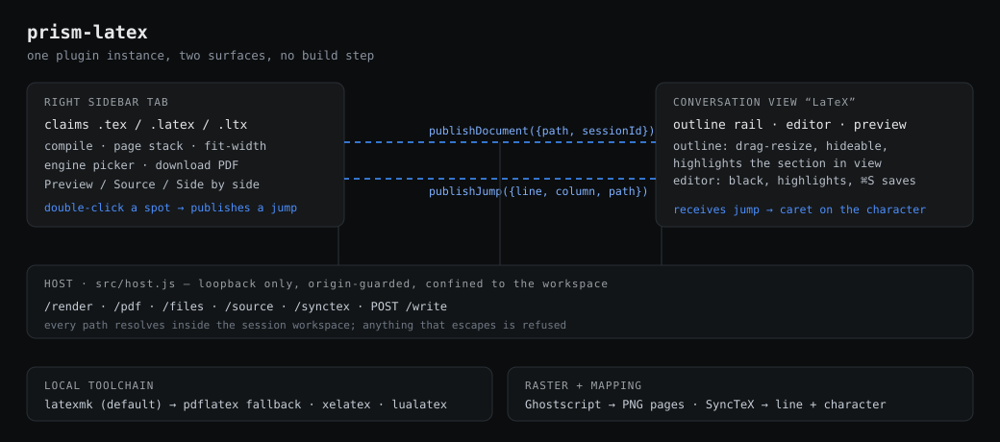
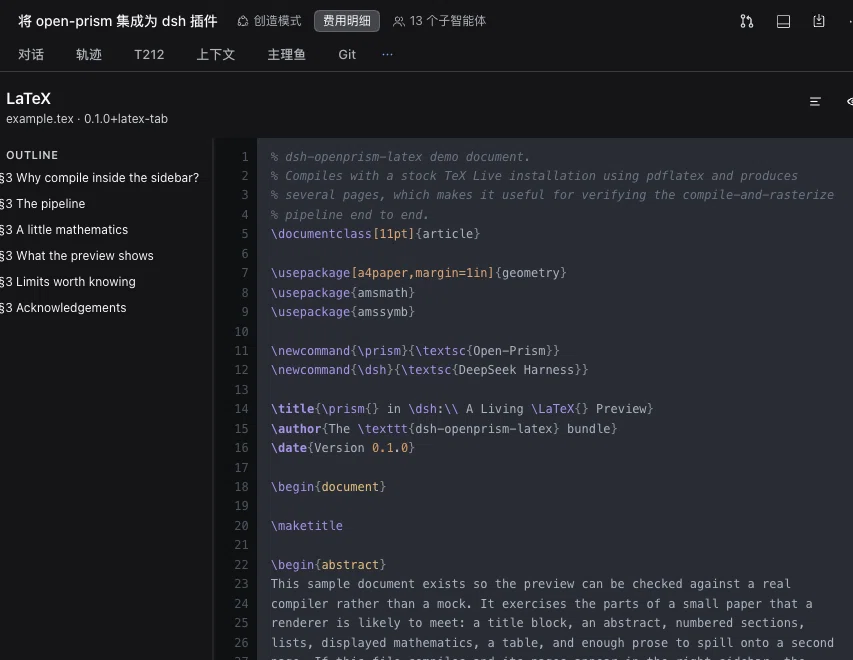
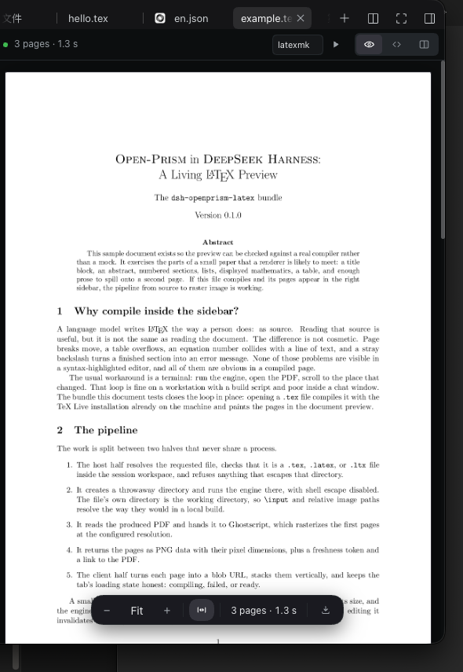
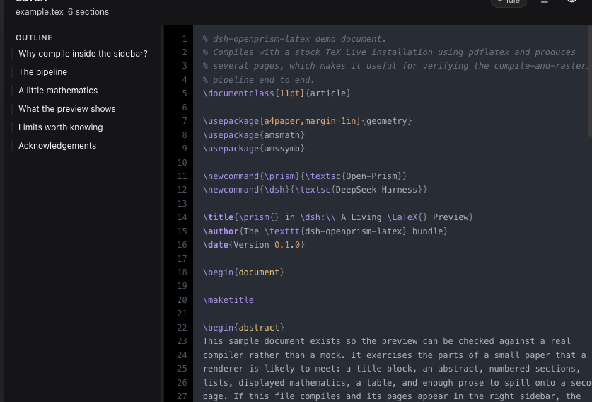

# dsh-openprism-latex

**Open-Prism style LaTeX editing for [DeepSeek Harness](https://github.com/deepseek-ai): the model writes `.tex`, you read a compiled document next to the source.**

A DSH bundle that compiles `.tex` with your local TeX Live and shows the pages inside DSH —
in the right sidebar and in a dedicated Conversation view with an editable source column.

Built on the idea behind [**Open-Prism**](https://github.com/assistant-ui/open-prism) — an
open-source AI LaTeX workspace with a live preview — brought into DSH. This is an independent
implementation, not a fork; see [Credits and provenance](#credits-and-provenance).

**English** · [中文](README_CN.md)

**Docs:** [Contributing](CONTRIBUTING.md) · [Changelog](CHANGELOG.md) · [Postmortem](POSTMORTEM.md) · [Design notes](SPEC.md)





<sub>Captured from the running app on macOS (dark theme): the Conversation view with its outline
rail, status pill and black editor; the right sidebar page stack.</sub>

---

## English

### What it does

```
model writes paper.tex  →  open it in the right sidebar (or follow the model's link)
                        →  the bundle compiles it with your TeX Live
                        →  pages render inline, fit-width, with zoom and PDF download
                        →  double-click a spot in the page: the editor's caret lands on that character
```

<p>
  
  
</p>

Two surfaces, one plugin instance:

| Surface | What it is |
|---|---|
| **Right sidebar tab** | The document reader. Claims `.tex` / `.latex` / `.ltx` files, compiles them, shows the page stack with fit-width/zoom, an engine picker, and Preview / Source / Side-by-side modes. |
| **Conversation view named `LaTeX`** | The writing surface, with the shell's native composer underneath. Outline rail on the left (drag to resize, hideable), source editor filling the middle, and an optional preview column (hidden by default) behind an eye toggle. The view follows whichever `.tex` the right sidebar is showing. |

### Features

**Rendering**
- Real compile, not a highlighter: the host runs the local TeX Live in the file's own directory, so
  `\input`, `\includegraphics` and relative paths behave exactly as in a local build.
- Engines: `latexmk` by default (repeats the run, drives BibTeX/Biber, so references and the table
  of contents resolve), with a `pdflatex` fallback; the picker also offers `xelatex` (CJK) and
  `lualatex`. The choice is remembered.
- Pages are rasterized with Ghostscript and shown as a vertical stack with fit-width, zoom steps up
  to 300 %, page count, compile time and a **Download PDF** button.
- Failures are readable and clickable: the message, its line and the compiler log tail; the line is
  a button that opens the source there.

**Editing** (in the `LaTeX` view)
- Syntax highlighting for LaTeX (the `codemirror-lang-latex` token grammar), line numbers, and a
  pure-black code surface so the code area is the focus of the view.
- The header shows the document name, an unsaved-changes dot and the section count; the build
  string lives in its tooltip. A status pill (`Ready · N pages` / `Compiling` / `Error` / `Idle`)
  is visible while the preview is collapsed and turns the preview on when clicked.
- The Outline rail highlights the section the editor is in and follows the scroll; with no document
  open the view shows a one-line empty state instead of empty columns.
- Find and replace, command completion, bracket and `\begin…\end` pairing, IME-safe input.
- **⌘S** saves through the host (writing the file and recompiling); a save is refused with a
  *changed on disk* banner instead of overwriting another writer. **⌘= / ⌘− / ⌘0** change the editor
  type size (10–20 px, remembered). **⌘↩** compiles.
- Sticky section header: the current `\section` stays at the top of the editor and jumps there when
  clicked. The Outline rail mirrors the same sections.
- **SyncTeX inverse search.** Double-click a spot on a rendered page: the editor's caret lands on
  that character and the line flashes. The click is mapped over the *typeset* characters only, so
  markup such as `\textbf{…}`, `$e^{i\pi}$`, `\LaTeX{}` or `\texttt{.tex}` does not shift it. A
  double-click never changes the browsing pane's mode or the layout — it only publishes a jump.

### Requirements

- DeepSeek Harness desktop with the web client.
- A local TeX Live installation (`latexmk`, `pdflatex`, `xelatex`, `lualatex` as needed) and
  Ghostscript. The host looks in `/Library/TeX/texbin` and `PATH`.
- No Node dependencies, no build step: `src/host.js` and `src/client.js` are shipped as they are.

### Install

The bundle is installed into a DSH profile like any other plugin package: add it as a dependency of
the profile (a `link:` dependency works for a local checkout), add its package name to
`dsh.profile.bundles`, and restart DSH. The bundle registers its `cordis.patch.yml` (host half) and
its client half through `dsh.client`.

```jsonc
// profile package.json (excerpt)
{
  "dependencies": { "dsh-openprism-latex": "link:/path/to/dsh-openprism-latex" },
  "dsh": { "profile": { "bundles": ["dsh-openprism-latex"] } }
}
```

Client code is served once per launch: **quit and reopen DSH after changing `src/client.js`.**
`⌘R` keeps the old bytes.

### Usage

1. Open a `.tex` file (the model's link, the file tree, or any DSH resource address). It opens in
   the right sidebar and compiles.
2. Switch between **Preview**, **Source** and **Side by side** in that tab; pick an engine; download
   the PDF.
3. Open the **`LaTeX`** view in the conversation's view row to edit the same document: the outline
   rail on the left, the editor in the middle, the preview behind the eye toggle.
4. Double-click a spot on any rendered page to move the caret there.

Try `demo/showcase.tex` — it exercises a title block, an abstract, numbered sections, lists,
displayed mathematics, a table and multiple pages.

### How it is built

| Half | File | Role |
|---|---|---|
| Host | `src/host.js` | Cordis plugin: HTTP routes, compile pipeline, SyncTeX queries, workspace file access. |
| Client | `src/client.js` | One classic script loaded by the DSH module loader; may only `require('react')`. |
| Patch | `cordis.patch.yml` | Declares the host plugin so the profile loads it. |

Host routes are loopback-only and origin-guarded, and every path is confined to the workspace root:

| Route | Purpose |
|---|---|
| `GET /render` | Compile and rasterize pages (PNG data + dimensions + freshness token). |
| `GET /pdf` | The compiled PDF for download/viewing. |
| `GET /files` | List the workspace's `.tex` documents. |
| `GET /source` | Read one file (version token, size limit). |
| `GET /synctex` | Map a page coordinate to `{ path, line, column }`. |
| `POST /write` | Save a file, refusing when the version token is stale. |

Cross-surface coordination uses two module-level channels rather than a service:
`publishDocument({ path, sessionId })` (the sidebar tells the view which file it shows) and
`publishJump({ line, column, path, sessionId })` (a page click moves the view's caret).

### Development

```bash
node --check src/host.js && node --check src/client.js
node scripts/smoke-host.mjs
OPRILX_REACT_PATH="$DSH_PROFILE_DIR/node_modules/react" node scripts/smoke-client.mjs
node scripts/check-pairing.mjs
```

The three suites run against stand-in DSH contexts: they cover the plugin, not the dock. A change
that touches tabs, the conversation view or scrolling needs one real relaunch check.

- `CLAUDE.md` — hard rules distilled from real regressions; read it before changing the sidebar.
- `POSTMORTEM.md` — the eight failures this project already paid for, with the exact code.
- `SPEC.md` — design notes for the compile pipeline and the editor.

### Status and known limits

- Inverse search (page → caret) is implemented; **forward search** (caret → page) is not yet.
- No word-wrap toggle: long lines scroll horizontally.
- The launcher icon and the left-rail panel were removed on purpose — there is one entry point, the
  `LaTeX` view.

### Credits and provenance

The product idea, UI direction and interaction model come from
[**assistant-ui/open-prism**](https://github.com/assistant-ui/open-prism) — an open-source,
AI-powered LaTeX editor with a live preview and a chat sidebar. This project brings that idea to
DeepSeek Harness as a bundle.

The implementation here is independent code written for the DSH plugin API (host routes, the
`sidebarRightTabs` document type, the `conversation.view` slot, the SyncTeX bridge). Where a
behaviour is borrowed conceptually — the three-column editor, the token grammar for highlighting,
the fit-width page stack — the source is named in the code and in `THIRD_PARTY_NOTICES.md`.

### License

MIT — see [`LICENSE`](LICENSE). Third-party notices: [`THIRD_PARTY_NOTICES.md`](THIRD_PARTY_NOTICES.md).

---
