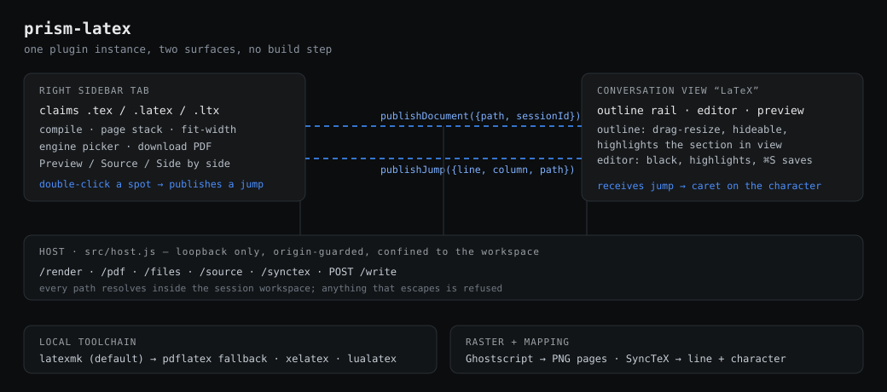
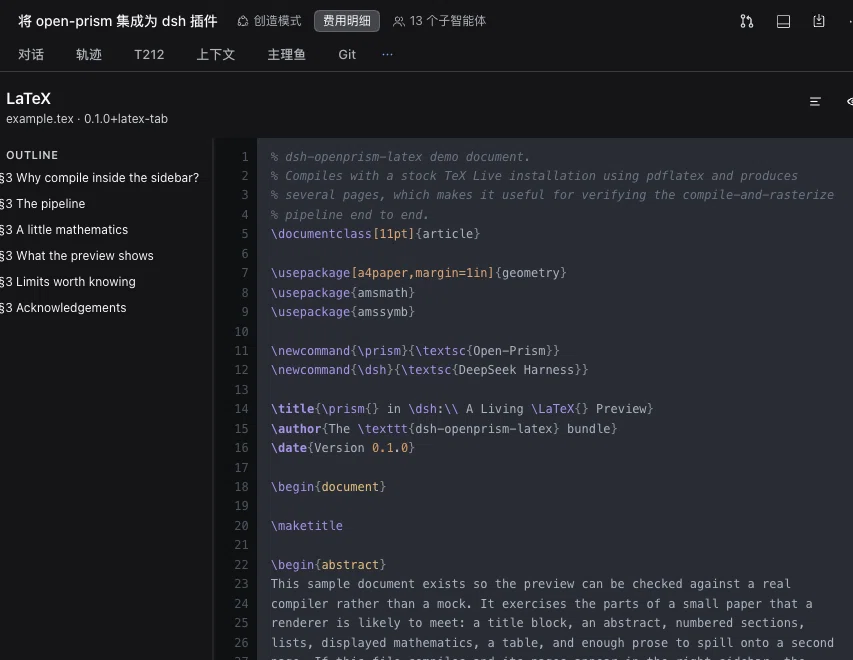
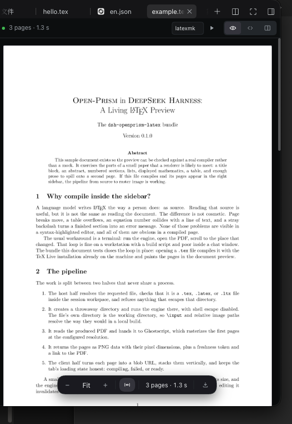
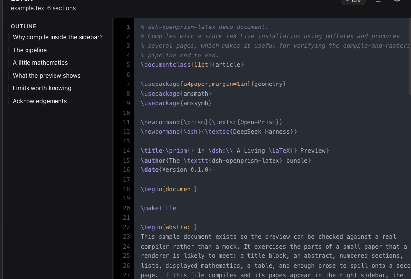

# prism-latex

**面向 [DeepSeek Harness](https://github.com/deepseek-ai) 的 Open-Prism 风格 LaTeX 编辑：模型写 `.tex`，你在源码旁边直接看到编译结果。**

一个 DSH 插件：用本机 TeX Live 编译 `.tex`，并把页面显示在 DSH 里——右侧边栏可看文档，专门的 `LaTeX`
对话视图可改源码。





<sub>取自实机运行（macOS 深色主题）：会话视图的 Outline 轨道、状态胶囊与纯黑编辑器；右侧边栏的页面栈。</sub>

### 这是什么

一个 DeepSeek Harness（DSH）插件：用本机 TeX Live 编译 `.tex`，并把编译后的页面直接显示在 DSH
里——右侧边栏可看文档，专门的 `LaTeX` 视图可改源码。

[English](README.md) · **中文**

**Docs:** [Contributing](CONTRIBUTING.md) · [Changelog](CHANGELOG.md) · [Postmortem](POSTMORTEM.md) · [Design notes](SPEC.md)

思路来自开源项目 [**assistant-ui/open-prism**](https://github.com/assistant-ui/open-prism)（AI 驱动的
LaTeX 写作工作台 + 实时预览）。本项目是**为 DSH 插件 API 独立实现**的版本，不是 fork。

### 两个界面，一个插件

| 界面 | 作用 |
|---|---|
| **右侧边栏标签** | 看文档：接管 `.tex` / `.latex` / `.ltx`，编译后按页显示，支持适应宽度、缩放、下载 PDF、切换引擎，以及「预览 / 源码 / 并排」三种模式。 |
| **对话视图 `LaTeX`** | 写文档：左侧 Outline（可拖拽调宽、可隐藏），中间源码编辑器，右侧预览列（默认收起，眼睛图标展开），底部是 DSH 原生输入框。该视图会跟随右侧边栏当前打开的 `.tex`。 |

<p>
  
  
</p>

### 功能

- **真的编译**：在文件所在目录调用本机 TeX Live，`\input`、`\includegraphics`、相对路径的行为与本地
  构建一致。默认 `latexmk`（多遍 + BibTeX，目录与参考文献能解析），可切 `pdflatex`、`xelatex`（中文）、
  `lualatex`，选择会被记住。
- **按页渲染**：Ghostscript 栅格化，适应宽度、最高 300% 缩放、显示页数与编译耗时、可下载 PDF。
- **报错可读可跳**：显示错误信息、行号、日志尾部；点行号直接跳到源码对应行。
- **源码编辑**：LaTeX 语法着色、行号、纯黑代码区；头部显示文件名、未保存脏点与章节数（构建号在 tooltip
  里）；预览收起时头部有状态胶囊（`Ready · N 页` / `Compiling` / `Error` / `Idle`），点它展开预览；
  没有文档时显示一行空状态而不是空列。
- **Outline 联动**：滚动时高亮当前章节；查找替换、命令补全、括号与 `\begin…\end` 配对；
  `⌘S` 保存并重编译（文件被他人改动时拒绝覆盖并提示）、`⌘=` / `⌘-` / `⌘0` 调字号、`⌘↩` 编译。
- **粘性章节条**：滚动时当前 `\section` 吸顶显示，点击可跳转；与左侧 Outline 同源。
- **SyncTeX 反向跳转**：在渲染页上双击，编辑器光标落到**你点的那个字符**上并闪烁该行。点击位置只在
  「会排版的字符」上做映射，所以 `\textbf{…}`、`$e^{i\pi}$`、`\LaTeX{}`、`\texttt{.tex}` 等标记不会造成偏移。
  双击**不会**改变浏览界面的模式或布局，只发布一次跳转。

### 环境要求

- DeepSeek Harness 桌面版（带 Web 客户端）。
- 本机 TeX Live（按需提供 `latexmk` / `pdflatex` / `xelatex` / `lualatex`）与 Ghostscript。默认查找
  `/Library/TeX/texbin` 与 `PATH`。
- 无 Node 依赖、无构建步骤：`src/host.js` 与 `src/client.js` 直接发布。

### 安装

`prism-latex` 已发布到 npm。与普通 DSH 插件相同：把本包加入 profile 依赖，把包名加入
`dsh.profile.bundles`，然后重启 DSH。宿主半（`cordis.patch.yml`）与客户端半（`dsh.client`）由包清单声明。

```jsonc
// profile package.json（节选）
{
  "dependencies": { "prism-latex": "^0.2.0" },
  "dsh": { "profile": { "bundles": ["prism-latex"] } }
}
```

本地开发用 `link:` 指向检出目录效果相同；Release 里的 tarball 用 `file:` 规格安装。

**修改 `src/client.js` 后必须完全退出并重开 DSH**：客户端包每次启动只加载一次，`⌘R` 仍是旧代码。

### 使用

1. 打开任意 `.tex`（模型给的链接、文件树或资源地址）→ 右侧边栏编译并显示。
2. 在该标签里切换「预览 / 源码 / 并排」、选引擎、下载 PDF。
3. 在顶部视图行点开 **`LaTeX`** 视图编辑同一篇文档：左侧 Outline、中间编辑器、右侧预览（眼睛图标展开）。
4. 在任意渲染页上双击，光标跳到对应字符。

可以从 `demo/showcase.tex` 开始——它覆盖标题块、摘要、编号章节、列表、公式、表格与多页。

### 宿主路由

均为仅本机、带来源校验，且路径限制在工作区内：`/render`（编译并栅格化）、`/pdf`、`/files`、
`/source`、`/synctex`（页面坐标 → 行/列）、`POST /write`（带版本校验的保存）。

跨界面协作走两个模块级通道：`publishDocument`（右侧栏告诉视图它正显示哪个文件）与
`publishJump`（页面点击把光标位置发给视图）。

### 开发

```bash
node --check src/host.js && node --check src/client.js
node scripts/smoke-host.mjs
PRISMLX_REACT_PATH="$DSH_PROFILE_DIR/node_modules/react" node scripts/smoke-client.mjs
node scripts/check-pairing.mjs
```

三套测试跑在**模拟的 DSH 上下文**上：它们证明插件自己是对的，不证明停靠栏行为。涉及标签、对话视图、
滚动的改动必须再做一次真实重启验证。详见 `CLAUDE.md`（硬规则）与 `POSTMORTEM.md`（八个已踩过的坑）。

### 已知限制

- 已有「页面 → 光标」的反向搜索；「光标 → 页面」的正向搜索尚未实现。
- 暂无自动换行开关，长行横向滚动。
- 启动图标与左侧面板是有意移除的：入口只有 `LaTeX` 视图一个。

### 来源与许可

- 产品与交互思路：**[assistant-ui/open-prism](https://github.com/assistant-ui/open-prism)**。
- 这里的实现是为 DSH 插件 API 独立编写的代码；借用概念的出处（三栏编辑器、着色 token 语法、
  适应宽度的页面栈）在代码与 `THIRD_PARTY_NOTICES.md` 中标注。
- 许可：MIT，见 [`LICENSE`](LICENSE)。
